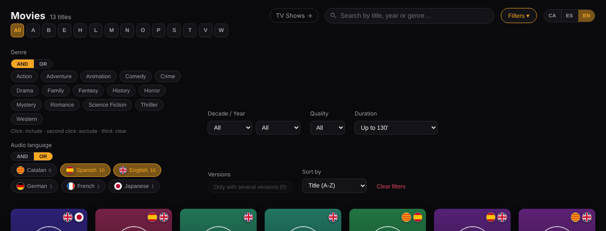
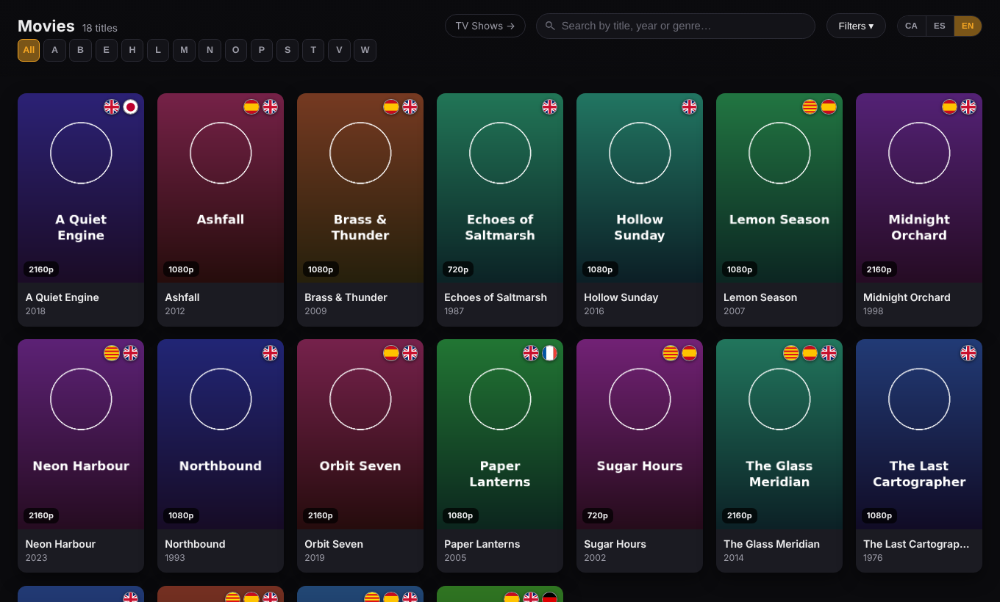

# Modern Grid for tinyMediaManager

A set of **export templates for [tinyMediaManager](https://www.tinymediamanager.org/) (tMM)** that turn your
library into a fast, dark, poster-grid website: one template for **movies**, one for **TV shows**, one for
**movie collections**, plus an optional landing page with global search and a statistics page.

Everything is plain HTML, CSS and JavaScript. **No server, no build step, no external dependencies** — export
from tMM, copy the folder to a web server (or just double-click `movielist.html`) and it works.

**Each template is standalone**, like the ones that ship with tMM: it simply produces its own `movielist.html`
(or `tvshows.html`, `moviesets.html`), and you can install just one of them. The landing page that links the three
together is an optional extra.

I built it because I wanted my own collection to look like a streaming service, minus the monthly fee and the
"are you still watching?" guilt trip. It has been through many rounds against my real library, so it has
survived more odd file names than any sane person should have to look at.





*Screenshots use invented titles and generated posters.*

## Features

**Browsing**

- Poster grid with live search (title, year, genre), an A–Z bar and sorting.
- **One card per title**: several versions of the same film (other edition, other resolution, same TMDb/IMDb ID)
  are grouped into one card with a ×N badge; the detail page lists all versions and links between them.
- Quality badge (2160p / 1080p / 720p / SD) and **audio-language flags** on every card, read from your
  media files.
- Detail pages with hero image, synopsis, cast, crew, studios, technical table, watched / pending mark,
  collapsible seasons on TV shows. Actors, directors and studios are clickable and filter the list.
- Interface in **Catalan, Spanish and English** (switch in the top-right corner, remembered in the browser; English by default).

**Filters** (movies; the TV list has the ones that make sense for shows)

- Genre with **AND / OR** switch and excluded genres (click once to include, twice to exclude, three times to clear).
- Decade → year, collection, quality, **audio language** (AND / OR), **duration** ("up to 100 minutes", "over 160",
  "unknown"), "only titles with several versions".
- All filter state lives in the **URL** (`?genre=Drama&audio=en&duration=100&sort=year-desc`), so a filtered view can
  be bookmarked, shared, and survives the browser's Back button.

**Landing page (optional, `Home/`)**

- Hub with the three sections and live counters.
- **Global search** across movies, shows and collections (alternative titles included).
- **Statistics page**: totals, hours of film, disk size, quality, audio languages, titles by decade, top genres.
  Every chart has a "Table" toggle.

## Requirements

- tinyMediaManager with the JMTE export engine (the templates use `${…}` expressions, `${if}` and `${foreach}`).
  The templates were developed and tested against my own libraries, so your mileage may vary.
- A modern browser.
- For the **global search and the statistics page** the site must be served over **http(s)** (any static web
  server: nginx, Apache, Caddy, a NAS web station, GitHub Pages, `python -m http.server`…). They read the list
  pages with `fetch`, which browsers block on `file://`. Every other page works from disk.

## Installation

Download the zips from the [latest release](../../releases/latest):

| Zip | Contents |
|---|---|
| `ModernMovies.zip` | Movie template |
| `ModernTVShows.zip` | TV show template |
| `ModernCollections.zip` | Movie-set (collection) template |
| `ModernGrid-Home.zip` | Landing page, statistics page and `config.js` |
| `ModernGrid-all.zip` | Everything above in one zip: `tmm-templates/` (goes into tMM) and `site-root/` (goes in the web root), plus README, CHANGELOG and licence |

1. Unzip each template **as its own folder** into tMM's `templates` directory (tMM's data folder; in the app:
   the folder opened from tMM's **Tools** menu, then `templates`). Each template folder must be a sibling of the others and
   contain its own `template.conf`; don't nest one inside another.
2. Restart tMM (or reopen the export dialog) so it detects them.
3. Select what you want to export and choose **Export**:
   - movies → *Modern Grid - Movies*
   - TV shows → *Modern Grid - TV Shows*
   - collections → select the movie sets (not the movies) and use *Modern Grid - Collections*
4. Export each kind into its **own folder** under a common root (see below).

### Site layout

```
my-site/
├── index.html        ← from ModernGrid-Home.zip (optional)
├── stats.html        ← from ModernGrid-Home.zip (optional)
├── config.js         ← from ModernGrid-Home.zip (optional: links the exports together; also language settings)
├── movies/           ← export of "Modern Grid - Movies"       (movielist.html, movies/…)
├── tvshows/          ← export of "Modern Grid - TV Shows"     (tvshows.html, <show>/tvshow.html)
└── collections/      ← export of "Modern Grid - Collections"  (moviesets.html, <collection>/movieset.html)
```

If you want the three exports linked (header buttons, "collection" chips on movie pages, movies inside a
collection), keep them as **siblings** and put `config.js` at the root, as described next. Without `config.js`
each export stands alone and shows no links to the others, so nothing ever points at a page that does not exist.
The default folder names are `movies`, `tvshows` and `collections`.

### Linking the exports together (`config.js`)

`config.js` (from `ModernGrid-Home.zip`) goes at the root of the site, next to `index.html`. With its `routes`
present the exports link to each other; edit the names if your folders are called something else:

```js
window.TMM_CONFIG = {
  routes: {
    movies: "films",       // folder that contains movielist.html
    tvshows: "series",     // folder that contains tvshows.html
    collections: null      // null or "" = "I don't have this": its buttons and links are hidden
  }
};
```

You can rename a folder later by editing this one file; nothing has to be exported again. If `config.js` is
missing, or has no `routes`, the exports are standalone and show no links to each other (the landing page, if you
use it, falls back to the default folder names).

### Languages from the file name (`languageSource`)

By default the audio languages come from the tags inside the media files. If you curate them yourself (for
example you fill in the "Spoken languages" field in tMM and put `${language}` in your renamer pattern), set

```js
window.TMM_CONFIG = {
  languageSource: "filename"   // "tracks" (default) | "filename"
};
```

and the languages are read from the export file name, for instance
`Example Film (2001) [Remastered] [CA,ES,EN,JA] [1080p] [h265] {tmdb=1234}.html` gives CA, ES, EN, JA. A bracket group is
used only if **everything** in it is a language code of 2-3 letters (separators: `,` `.` `/` `+` `&` or a space;
`[es, en]` and `[ES.EN]` work too). `[Remastered]`, `[1080p]`, `[h265]` or `[AC3 6ch 5.1]` are ignored. This needs
no re-export: the file name is already in the links of the list pages.

### Language codes

The audio languages are identified by **ISO 639-1 codes** (two letters, case-insensitive): `ca`, `es`, `en`,
`fr`, `de`, `ja`, `zh` (Chinese), `ko`... The usual three-letter ISO 639-2 codes (`spa`, `eng`, `cat`, `fra`, `deu`,
`jpn`, `zho`, `eus`...) are converted to their two-letter equivalent. Round flags are built in for `es`, `ca`, `en`, `fr`, `de`, `it`, `pt`, `ja`, `ko`, `zh`,
`ru`, `nl`, `pl`, `sv` and `tr`; any other valid code gets a round badge with the code (`EU`, `GL`...) and its
name, translated into the interface language, on hover. Only codes that are real languages are read from file
names, so tags like `[DC]` or `[HD]` are ignored (a lone `[IA]`, however, is the code of Interlingua and would be read).

#### Regions, `zxx` and variants

- **Regions are read but dropped**, exactly as tMM itself does: `pt-BR` counts as Portuguese, `es-MX` and `es-419`
  as Spanish, `es-ES` as Spanish (`-` or `_`, any case). You can write them in a file name (`[ES,PT-BR]`) without
  breaking the bracket group, and identical codes merge (`ES`, `es` and `es-ES` are one language).
- **`zxx`** (ISO 639-2 "no linguistic content", what tMM uses for silent films; it has no two-letter code) is built in:
  it shows a "ZXX" badge named "Silent (no dialogue)". `und` (undetermined) and `mul` (multiple) are ignored.
- **To keep a variant apart**, declare it in `languageCodes`. For an ISO variant the minimum is an empty entry:
  `"pt-BR": {}` gives it its own entry, with the Portuguese flag, the mark "BR" and the automatic name
  "Brazilian Portuguese" (translated into the interface language). `name`, `flag` and `mark` override the defaults.
  Declared variants are matched case-insensitively, with `-` or `_`.

#### Your own codes

If you need codes of your own (tMM itself may not accept them), declare them in `config.js`:

```js
window.TMM_CONFIG = {
  languageCodes: {
    // "la" is Latin in ISO; here it means Latin American Spanish, shown as the Spanish flag with "LA" on it
    la: { name: { ca: "Castellà llatinoamericà", es: "Español latino", en: "Latin American Spanish" },
          flag: "es", mark: "LA" }
  }
};
```

`name` can be a plain string or an object per interface language, `flag` reuses the flag of a built-in language
and `mark` (up to 3 letters) is drawn over it. A custom code counts as its own language in the filter and in the
statistics, and wins over the standard meaning of the same code. Custom codes must be 2-3 letters.
To make one of your codes the same language as another, give it an `alias` instead of a name/flag:
`languageCodes: { br: { alias: "pt-BR" } }` merges `br` into `pt-BR`, as long as you have declared `"pt-BR"` itself.

#### Adding a variant that reuses an existing flag (e.g. Brazilian Portuguese)

For an ISO variant, `"pt-BR": {}` is enough (see above). For a variant that has no ISO code, or if you want your own
wording or mark, add a line to `languageCodes` in `config.js`, borrow the flag with `flag` and tell the two apart
with `mark`:

```js
languageCodes: {
  pb: { name: { ca: "Portuguès del Brasil", es: "Portugués de Brasil", en: "Brazilian Portuguese" },
        flag: "pt", mark: "BR" }
}
```

Then write `PB` in your tMM languages / file names (`[ES,PB,EN]`). The code (`pb` here) is only a label of
yours: choose any 2-3 letters that do not collide with a language you also use.

#### A real example: Latin American Spanish as `LA`

My own collection is where all this comes from, so here is how I do it. I let tMM's renamer build curated file
names that carry the audio languages, which I fill in by hand in tMM's spoken-languages field from what I hear
in each file (I trust my ears more than the tags of whatever release I downloaded). My movie renamer pattern is:

```
${titleSortable} (${year}) [${edition}] [${language}] [${videoFormat}] [${videoCodec}] [${audioCodec} ${audioChannels} ${audioChannelsDot}] {tmdb=${tmdb}}
```

which produces names like these (the titles are made up, and when `edition` is empty in tMM that whole `[…]` piece
is simply not generated):

```
Example Film(2001) [Remastered] [ca, es, en, JP] [1080p] [h265] [AC3 2ch 2.0] {tmdb=1234}.html
Example Film(2001) [ca, es, LA, en] [2160p] [h265] [DTSHD-MA 6ch 5.1] {tmdb=1234}.html
```

Only the bracket group with nothing but language codes is read; `[Remastered]`, `[1080p]`, `[AC3 2ch 2.0]` and the
rest are ignored. So my `config.js` says to read the languages from the file name, and it also handles one little
problem: I use `LA` for Latin American Spanish, but tMM, and ISO, read `LA` as **Latin**. Unless you are
cataloguing a lot of films in the language of the Roman Empire (no judgement), that is not what you want, so I
declare it myself (Spanish flag with "LA" on it):

```js
window.TMM_CONFIG = {
  languageSource: "filename",
  languageCodes: {
    la: { name: { ca: "Castellà llatinoamericà", es: "Español latino", en: "Latin American Spanish" },
          flag: "es", mark: "LA" }
  }
};
```

Without that entry, `LA` is shown as Latin, which is correct for ISO and wrong for my shelf. The same recipe works
for any convention of your own: write the code you like in the file name and declare what it means in
`languageCodes`.

#### Adding a flag that does not exist yet

Only the languages listed above have a drawn flag. To add another one:

1. In `ModernMovies/app.js`, find `var FLAGS = {` and add a line with the **inner** SVG markup of the flag, drawn
   in a `0 0 60 40` box (the template crops it into a circle, so keep the important parts near the centre). Use
   a name **longer than 3 letters** as the key, so it can never be mistaken for a language code in a file name:

   ```js
   brazil: '<rect width="60" height="40" fill="#009c3b"/><polygon points="30,4 56,20 30,36 4,20" fill="#ffdf00"/><circle cx="30" cy="20" r="8" fill="#002776"/>',
   ```

2. Copy that `app.js` over `ModernTVShows/app.js` and `ModernCollections/app.js` (in this repo,
   `bash scripts/sync-appjs.sh` does it; the three files must be identical), and re-copy the templates to tMM.
3. Point a code at it in `config.js`: `languageCodes: { pb: { name: "Portugués de Brasil", flag: "brazil" } }`.

The statistics page shows languages by name only, so it needs no flag.

## URL parameters

List pages understand these query parameters (all optional, combinable):

| Parameter | Meaning |
|---|---|
| `q` | Free-text search |
| `genre`, `xgenre` | Included / excluded genre (repeatable); `gmode=or` switches to "any of" |
| `decade`, `year` | Decade (e.g. `1990`) and year |
| `quality` | `2160p`, `1080p`, `720p`, `SD` |
| `audio` | Audio language code (repeatable, e.g. `audio=ca&audio=en`); `amode=and` requires all of them |
| `duration` | `40`, `70`, `90`, `100`, `110`, `120`, `130`, `160` (up to N minutes), `160+`, `unknown` |
| `versions=1` | Only titles with several versions |
| `collection`, `letter`, `sort` | Collection, initial letter, sort order |
| `actor`, `director`, `studio` | Filter by person / studio |

## Things worth knowing

- **Two entries with the same title and year collide.** tMM names the detail page and the artwork after the
  title/folder name, so two library entries that render to the same name (for example two TV shows both called
  "Dragon Ball Z (1989)") overwrite each other in the export. The template detects it and shows a warning, but
  cannot fix it: give them different titles, years or folder names in tMM.
- **Versions** are grouped by scraper ID (TMDb, then IMDb for movies; TMDb, then TVDb, then IMDb for shows).
  Entries without an ID are never grouped.
- **Duration** comes from the runtime tMM stores for the title (normally the scraper's value, which includes
  the end credits), not from measuring your files. For TV shows it is a single per-episode value per show.
  Titles without a runtime only match the "unknown" option.
- **Audio languages** (flags, filter, statistics) come, by default, from the language tag of each audio stream
  as tMM reports it. Streams without a tag are ignored, and if no file has any language data the filter is
  hidden. If you would rather use your own curated data, set `languageSource: "filename"` in `config.js`:
  the languages are then read from the file name of each entry (see below).
- Older tMM releases abort a collection export if a collection title contains `:` or `/`
  (they are used as folder names). Rename those collections in tMM, or update tMM.
- The default interface language is English; use the CA / ES / EN switch (the choice is remembered in the browser).
  To change the default, edit `getLang` in `app.js`, `Home/index.html` and `Home/stats.html`.

## Development

- `ModernMovies/app.js`, `ModernTVShows/app.js` and `ModernCollections/app.js` are **byte-identical**: each
  template folder has to be self-contained for tMM, so the file is duplicated. Edit
  `ModernMovies/app.js` and run `bash scripts/sync-appjs.sh` (or `bash scripts/check-sync.sh` to just verify).
  `ModernCollections/style.css` intentionally differs from the other two.
- `bash scripts/build-release.sh [version]` writes the zips described above to `dist/`.
- Pushing a tag like `v0.24.0` runs `.github/workflows/release.yml`, which verifies the sync, builds the
  zips and attaches them to a GitHub Release.
- Source comments are mostly in Catalan, because that is the language I think and swear in. A translator will get you there.

## Support

This is a personal project that I'm sharing in case it is useful to someone else. **It is provided as is and
I don't offer support or maintain it for others**: issues and pull requests may go unanswered, and not out of
rudeness, it is just that my free time is already spoken for. The licence is permissive on purpose, so feel free
to fork it and adapt it to your own library. If it breaks, you now own the pieces (and I wish you well).

## Changelog

See [CHANGELOG.md](CHANGELOG.md). Latest: **0.24.0** — first public release (English defaults for folder
names, English docs, release tooling), on top of 0.23.0 (duration filter on TV shows, "unknown runtime" option),
0.22.0 (duration filter), 0.21.x (audio-language filter with AND / OR), 0.20.0 (decade → year),
0.19.0 (statistics page), 0.18.0 (shared route config, global search).

## Licence

[MIT](LICENSE).
